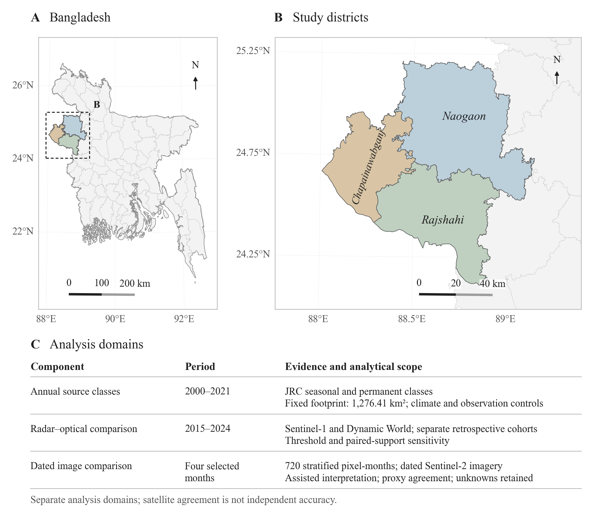

# Mapped seasonal surface water decline under changing observation support in northwestern Bangladesh

Official data and code repository for the manuscript:
> **Mapped seasonal surface water decline under changing observation support in northwestern Bangladesh**  
> Asif Ahamed, Ahammad Hossain*, Md. Tanvir Hasan, Most. Alisa Tabassum, and A.H.M. Rahmatullah Imon  

[Manuscript (PDF)](manuscript/manuscript.pdf) · [Manuscript (Word)](manuscript/manuscript.docx) · [Supplementary Methods (PDF)](manuscript/supplementary_methods.pdf) · [Reproduction Guide](docs/REPRODUCING.md) · [Data Dictionary](docs/DATA_DICTIONARY.md)



## Overview

This repository provides the complete analytical pipeline, processed datasets, and figure-generation scripts evaluating long-term seasonal and permanent surface-water dynamics across three drought-prone districts in northwestern Bangladesh (Naogaon, Chapainawabganj, and Rajshahi). The analytical design comprises three linked components:

1. **Annual source-class dynamics (2000–2021):** Evaluation of Landsat-derived JRC Global Surface Water seasonal and permanent classes across verified observation footprints (1,276.41 km² primary reference footprint; 1,271.76 km² strict 2000–2021 complete cohort; 1,196.72 km² baseline-water cohort), integrating CHIRPS v3 precipitation and ERA5-Land climate controls.
2. **Multi-sensor radar–optical evaluation (2015–2024):** Cross-sensor comparison between Sentinel-1 SAR and 10-m Dynamic World land-cover probabilities across confidence thresholds ($q \in \{0.5, 0.6, 0.7, 0.8\}$) and paired observational support.
3. **Stratified dated image interpretation:** Design-based evaluation of 720 stratified pixel-months across four selected months combining automated spectral triage with multi-date visual review.

## Reproducing the Reported Results

The analytical pipeline requires **Python 3.12**. From the repository root, run:

```powershell
python -m venv .venv
.venv\Scripts\python -m pip install -r code/requirements-dev.txt
.venv\Scripts\python code/reproduce_reported_results.py --output reproduced/results
.venv\Scripts\python -m pytest -q
```

All input and output artifacts are verified against cryptographic SHA-256 hashes recorded in `checksums.sha256`. Detailed step-by-step instructions are available in [docs/REPRODUCING.md](docs/REPRODUCING.md).

## Repository Structure

| Directory / File | Description |
| :--- | :--- |
| `code/earth_engine/` | Google Earth Engine (GEE) JavaScript export scripts for JRC, Sentinel-1, Dynamic World, and climate products |
| `code/research_pipeline/` | Core statistical modeling, HAC covariance estimation, circular block bootstrap, and spatial aggregation modules |
| `code/automatic_water/` | Dynamic World threshold sensitivity and paired radar–optical agreement scripts |
| `code/postprocessing/` | Spectral screening, dated pixel-month validation, and quality sensitivity scripts |
| `code/figure_sources/` | Scripts used to generate and format manuscript figures |
| `code/tests/` | Automated unit and integration test suite (pytest) |
| `data/boundaries/` | GeoJSON administrative reporting boundaries (geoBoundaries ADM2) |
| `data/inputs/` | Aggregated climate time series, pilot exports, and spectral screening inputs |
| `data/tables/` | Generated summary, regression, sensitivity, and validation CSV tables |
| `docs/` | Data dictionary, source documentation, file-to-result mapping, and reproduction notes |
| `figures/` | All 9 main manuscript figures in high-resolution PNG and TIFF/PDF formats |
| `manuscript/` | Final manuscript and supplementary methods in Word (.docx) and PDF (.pdf) formats |
| `provenance/` | SHA-256 verification manifests and computational audit records |

## License and Citation

Please see [docs/REUSE_AND_ACCESS.md](docs/REUSE_AND_ACCESS.md) for licensing details regarding original code and third-party satellite/climate datasets, and `CITATION.cff` for citation metadata.
